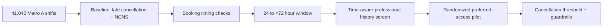

# Marketplace Reliability Case Study

This anonymized case study uses time-aware cohort analysis and observational risk segmentation to ask how a healthcare staffing marketplace could reduce late professional cancellations without hurting fill rate, time to fill, no-call/no-show rate, or access. I analyzed 41,040 Metro A shifts from supplied operational logs, checked denominators and data quality across shift- and event-grain records, identified a 24-to-under-72-hour booking window with the highest observed late-cancellation rate, and designed a 16-week randomized pilot with a primary metric and guardrails. The public edition keeps aggregate evidence and formula-backed checks; row-level records are not redistributed.

**Start here:** the [portfolio proposal](report/Marketplace_Reliability_Portfolio_Proposal.pdf), [evidence record](analysis/eda-methodology-and-evidence.md), and [formula-backed aggregate workbook](analysis/workbook/Marketplace_Reliability_Aggregate_Analysis.xlsx).

## What this demonstrates

| Concept | How it is implemented | Where to inspect it |
| --- | --- | --- |
| Time-aware cohort analysis | Compares booking-time cohorts and pre-booking professional history while preserving shift- and event-grain denominators | [`analysis/eda-methodology-and-evidence.md`](analysis/eda-methodology-and-evidence.md) |
| Denominator and data-quality checks | Validates outcome totals, timing-band totals, event chronology, and the target booking population | [`analysis/eda-methodology-and-evidence.md`](analysis/eda-methodology-and-evidence.md) |
| Observational risk segmentation | Uses only history available before booking to separate historical risk groups, without treating the comparison as causal | [`analysis/eda-methodology-and-evidence.md`](analysis/eda-methodology-and-evidence.md), [`analysis/issue-tree.md`](analysis/issue-tree.md) |
| Randomized pilot design | Converts observational evidence into a 16-week pilot with treatment, control, a primary decision threshold, and guardrails | [`report/`](report/), [`analysis/issue-tree.md`](analysis/issue-tree.md) |
| Spreadsheet analysis | Eight-sheet aggregate-only workbook uses visible formulas to reproduce published calculations and checks | [`analysis/workbook/`](analysis/workbook/) |
| Privacy-aware publication | Documents the withheld source and clean layers while exposing schemas, aggregate results, formulas, and method | [`data/`](data/), [`analysis/workbook/README.md`](analysis/workbook/README.md) |

## How the analysis moves from signal to test

1. I defined the Metro A shift log as the 41,040-shift analysis population, then matched the broader event logs to those Shift IDs for shift-level rates.
2. Late cancellation affected 2,486 shifts (6.06%); no-call/no-show affected 1,253 (3.05%). The outcomes remain separate because 67 shifts had both flags.
3. I compared booking lead time in two ways to reduce ambiguity from repeat bookings. In the first-booking view, 205 of 1,505 shifts booked 24 to under 72 hours before start later had a late cancellation (13.62%). In the exactly-one-booking check, the same window was highest again: 163 of 1,427 shifts (11.42%).
4. For 1,742 target-window booking decisions, I calculated professional history using only resolved shifts available before the booking. A screen of at least 10 prior resolved shifts and a prior late-cancellation rate below 10% identified 589 decisions, 44 of which later had a same-worker late cancellation (7.47%).
5. I translated that signal into a pilot: qualifying professionals receive 30 minutes of preferred access; an unfilled shift returns to the wider qualified pool; control shifts retain the existing flow.

## Proposed pilot

| Pilot element | Design |
| --- | --- |
| Population | Metro A open shifts entering the 24-to-under-72-hour window |
| Treatment | 30 minutes of preferred access for professionals with ≥10 prior resolved shifts and <10% prior late-cancellation rate |
| Control | Existing booking process |
| Duration | 16 weeks |
| Primary decision threshold | 3.5 percentage-point treatment-control change in late cancellation |
| Guardrails | No-call/no-show, fill rate, time to fill, and access for shorter-history professionals |

The 7.47% value is a historical benchmark for the proposed eligible group, not an expected treatment outcome. The workbook contains the reported aggregate numerators, denominators, formulas, sensitivity rows, and reconciliations.

## Repository map

| Path | Purpose |
| --- | --- |
| [`analysis/`](analysis/) | Issue tree and methodology/evidence record |
| [`analysis/workbook/`](analysis/workbook/) | Aggregate-only workbook, formulas, checks, and workbook guide |
| [`data/`](data/) | Source schema and documentation for withheld raw and clean layers |
| [`report/`](report/) | Anonymized pilot proposal PDF |

## Current status and limits

- The timing and history comparisons are observational; they select a testable window and rule, not a causal effect or pilot forecast.
- Event logs cover more records than the Metro A shift log, so shift-level rates use only matching Metro A Shift IDs.
- Some shifts have multiple booking events and earlier professional history may be incomplete.
- Before launch, the marketplace should refresh the baseline, confirm data completeness and sample size, and keep eligibility rules fixed during the test.

## Ownership

I developed the analytical method, pilot design, aggregate workbook, and public evidence record.
